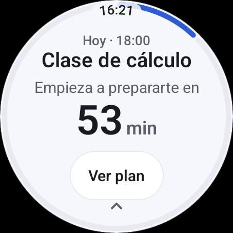
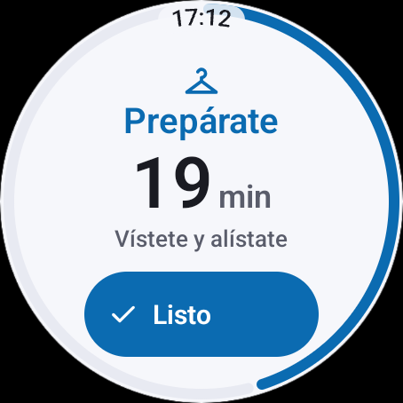
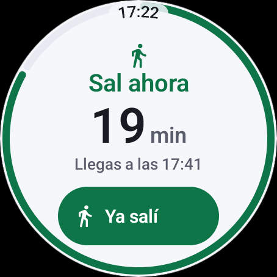
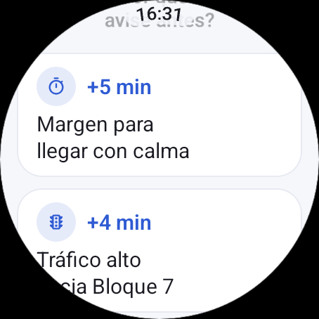

# TickGo

**Salir a tiempo, desde la muñeca.** TickGo es una app para relojes con **Wear OS** que te ayuda a empezar a
prepararte y salir con tiempo suficiente para llegar a una cita, una clase o un plan. No es una alarma fija:
divide la preparación en **4 estados** con vibraciones distintas, **aprende** cuánto tardas de verdad en cada
paso y te **explica** por qué te avisó a esa hora.

Proyecto de la materia **Diseño de Interfaces**. Entrega: martes 17 de noviembre de 2026.

<p align="center">
  
  
  
  
</p>

> Todas las capturas están en [`design/capturas/`](design/capturas/). El recorrido completo está en el video
> [`design/capturas/demo.mp4`](design/capturas/demo.mp4) (2 min 15 s).

## Cómo funciona

1. **Creas el evento por voz** ("Clase de cálculo mañana a las 8 en el bloque 7") y lo confirmas en el reloj.
2. **TickGo calcula el plan hacia atrás** desde la hora del evento: cuánto tardas en cada paso, el trayecto y un
   margen para llegar con calma.
3. **Te acompaña en 4 estados.** Cada uno tiene su color, su ícono y su vibración, para reconocerlo sin mirar:

   | # | Estado | Color | Vibración |
   |---|---|---|---|
   | 1 | Termina lo que haces | violeta | un toque suave |
   | 2 | Prepárate | azul | dos toques |
   | 3 | Revisa tus cosas (lista de objetos) | ámbar | tres toques rápidos |
   | 4 | Sal ahora | verde | dos vibraciones largas |
   | – | Vas tarde | rojo (con rayas en el resumen, nunca solo color) | tres vibraciones largas, máx. 3 veces |

4. **Aprende.** Cada "Listo" guarda cuánto tardaste. El resultado dice el efecto real: "Prepararte te tomó 22 min.
   La próxima vez te aviso 3 min antes."
5. **Explica.** "¿Por qué te avisé antes?" lista cada razón con sus minutos: lo que aprendió, el día de la semana,
   la lluvia, el tráfico, tus ajustes y el margen. Si algo no es así, lo corriges ahí mismo.
6. **Resume tu semana**: porcentaje de salidas a tiempo, barras por día y tu mejor día.

### La "IA" de estimación

Es una media móvil ponderada (α = 0,3) por rutina y paso, sin red neuronal: con pocos datos por persona es
igual de precisa, funciona sin conexión y se puede explicar razón por razón. A eso se suman:
- **Efecto del día:** con 3 registros o más de ese día, hasta ±10 min.
- **Lluvia y tráfico:** solo afectan el trayecto. La lluvia suma 15 %, con un mínimo de 2 min; el tráfico medio
  10 % y el alto 25 %.
- **Tu ajuste manual:** reemplaza lo aprendido.

Detalle completo en [docs/MODELO_ESTIMACION.md](docs/MODELO_ESTIMACION.md).

## Decisiones de diseño

- **El tiempo es el protagonista.** Cada pantalla responde de un vistazo "¿cuánto me queda?", con cifras grandes
  tabulares.
- **Tema claro principal y tema oscuro.** El tema automático se oscurece de 19:00 a 5:59. Todo el texto cumple un
  contraste ≥ 4,5:1, verificado con [`design/contraste.py`](design/contraste.py).
- **Color, ícono y vibración juntos.** Ningún estado depende solo del color.
- **Sin regaños.** "Saliste 4 min tarde", no "llegaste tarde otra vez".
- **Pantalla redonda primero.** Hay un área segura de 103 dp desde el centro y listas que se curvan con el borde.
  En pantallas pequeñas y cuadradas todo se escala; si el texto grande no cabe, se desplaza en vez de cortarse.
- **Modo ambiente.** Con la muñeca abajo, la preparación sigue visible en blanco sobre negro, con un anillo fino.
- **Sin pantalla de bienvenida.** En el reloj las sesiones duran segundos: la app se explica usándola, con datos de
  ejemplo, Inicio guía cuando no hay eventos y los permisos se piden en contexto (D-037).
- **Accesible.** Objetivos táctiles de 48 dp, descripciones habladas en anillos, barras y estados, y soporte de la
  corona para desplazar y ajustar.

Más en [docs/DISENO_UI.md](docs/DISENO_UI.md) (sistema de diseño y pantallas) y en
[docs/DECISIONES.md](docs/DECISIONES.md) (registro de decisiones D-001 a D-037).
El prototipo navegable en HTML está en [`design/prototipo/index.html`](design/prototipo/index.html).

## Compilar e instalar

Necesitas:
- **JDK 21**;
- **Android SDK** con la plataforma 36 y una imagen de sistema **Wear OS 6** (API 36);
- un emulador **Wear OS Large Round** o un reloj con Wear OS 3 o superior (`minSdk 30`).

```bash
./gradlew :wear:assembleDebug      # compilar
./gradlew test                     # 135 pruebas unitarias (estimador, motor de estados, intérprete de voz…)
./gradlew :wear:installDebug       # instalar en el emulador o reloj conectado
```

En Windows usa `gradlew.bat`. La app trae datos de ejemplo: tres rutinas, eventos próximos y dos semanas de
historial.

## Cómo presentar la demo

1. En **Eventos → Ajustes**, mantén presionado "TickGo · versión 0.1" para descubrir el **modo demo**. En ese
   modo, 1 min pasa en 5 s.
2. Con el modo demo activo:
   - **"Ir al próximo aviso"** salta a segundos antes del primer aviso.
   - **"Simulación"** permite poner lluvia y tráfico, y ver cómo se mueve la hora de salida.
3. Recorre los 4 estados con "Listo" y termina con "Ya salí" para ver el resultado y lo aprendido.

## Arquitectura

- Kotlin, Jetpack Compose for Wear OS y Wear Compose Material 3.
- Una sola Activity, MVVM con `StateFlow` e inyección manual (`AppContainer`).
- Room para eventos e historial; DataStore para preferencias.
- Lógica en clases puras de Kotlin con pruebas:
  - `PrepStateMachine`, el motor de los 4 estados;
  - `DurationEstimator`;
  - el intérprete de voz;
  - `ReasonPhrases`.
- Alarmas exactas para que los avisos lleguen con la app cerrada.

Ver [docs/ARQUITECTURA.md](docs/ARQUITECTURA.md).

## Límites conocidos

- **Sin app de teléfono ni Data Layer (D-002).** Clima y tráfico son simulados (D-003).
- **El trayecto no aprende de tus salidas.** Sin ubicación no se sabe cuándo llegaste (D-004, D-033).
- **Modo demo:** si el sistema cierra la app en modo demo, la hora acelerada vuelve a la hora real (D-029).
- **No es una herramienta de salud.** TickGo ayuda a organizar el tiempo; no diagnostica ni trata ninguna
  condición.

## Documentación

| Documento | Contenido |
|---|---|
| [docs/PROPUESTA.md](docs/PROPUESTA.md) | Propuesta original |
| [docs/PLAN.md](docs/PLAN.md) | Plan por fases y estado de cada tarea |
| [docs/DISENO_UI.md](docs/DISENO_UI.md) | Sistema de diseño, pantallas y patrones hápticos |
| [docs/ARQUITECTURA.md](docs/ARQUITECTURA.md) | Arquitectura técnica |
| [docs/MODELO_ESTIMACION.md](docs/MODELO_ESTIMACION.md) | Modelo de estimación |
| [docs/DECISIONES.md](docs/DECISIONES.md) | Registro de decisiones |
